# MATERIAL TALLY HUB — DYNAMIC WORKFLOW SPECIFICATION (`flow.md`)
> **Dokumen Spesifikasi Alur Kerja Dinamis: 2-Tahap (Bypass QC) vs 3-Tahap (Dengan QC)**  
> *Plant 2111 Cibitung — PT Diamond Cold Storage*

---

## 📌 1. Latar Belakang & Tujuan

Saat ini sistem **Material Tally Hub** menggunakan alur kerja 3-tahap baku:  
**`Checker (Hitung Fisik)` ➔ `Admin Warehouse (Verifikasi Dokumen)` ➔ `QC (Uji Mutu & Stock Ter-UU)`**.

Kebutuhan operasional terbaru:
1. **Penyederhanaan Proses**: Perusahaan menginginkan alur yang lebih ringkas di mana dokumen kedatangan material cukup diselesaikan dari **Checker** ke **Admin Warehouse** langsung menjadi `completed` (Stock Ter-UU), tanpa perlu menunggu tahapan tim QC.
2. **Kesiapan Masa Depan (Zero Breaking Change)**: Kode, peran (role), dan fungsionalitas QC **tidak boleh dihapus**.
3. **Pengaturan Dinamis (Configurable Switch)**: Super Administrator dapat mematikan (*disable*) atau menyalakan kembali (*enable*) fungsi QC sewaktu-waktu melalui menu **Pengaturan Sistem (`/settings`)**.

---

## ⚙️ 2. Arsitektur Konfigurasi Dinamis

Pengaturan disimpan pada tabel `settings` (global configuration) di SQLite lokal dan Supabase Cloud.

### Schema Pengaturan:
```json
{
  "id": "global",
  "qc_enabled": false,
  "required": {
    "batch_fisik": true,
    "supplier_batch": true,
    "expired_date": true,
    "production_date": true,
    "pic": true
  },
  "duplicate_rule": "within_document",
  "hold_categories": [...],
  "qa_documents": {...},
  "role_permissions": {...},
  "webhook_config": {...}
}
```

* **Default Value**: `qc_enabled: true` (backward compatible dengan data yang ada).
* **Hak Akses Toggle**: Hanya role `admin` (Super Administrator).
* **Audit Trail**: Setiap perubahan toggle QC dicatat di log aktivitas sistem (`activity_logs`).

---

## 🔄 3. Diagram Alur Kerja (Mode Bypass QC & Alur GR vs UU)

```mermaid
graph TD
    subgraph MODE_OFF["ALUR OPERASIONAL GUDANG (QC NONAKTIF)"]
        D[Draft: Input Fisik Checker] -->|submit_to_admin| WA[waiting_admin: Verifikasi Admin WH]
        
        %% Jalur 1: Masalah Fisik Berat (Belum Boleh GR di SAP)
        WA -->|admin_hold: Kendala Fisik/PO| AH[admin_hold: Tertahan / Belum GR]
        AH -->|unhold / return| D

        %% Jalur 2: Opsi A - Sudah di-GR tapi Belum Ter-UU (Menunggu COA / Dokumen)
        WA -->|post_gr_pending: Input No. GR SAP + Alasan Pending| GD[gr_done: SUDAH DI-GR / PENDING UU]
        GD -->|release_to_uu: COA Tiba & Dokumen Lengkap| COMP((completed: STOCK TER-UU))

        %% Jalur 3: Langsung GR & Ter-UU (Semua Lengkap sejak Awal)
        WA -->|admin_approve: Selesai Langsung| COMP

        %% Jalur 4: Revisi Fisik
        WA -->|return_to_checker| D
    end

    subgraph MODE_ON["ALUR STANDAR (JIKA QC DIAKTIFKAN KEMBALI)"]
        D2[Draft: Checker] -->|submit_to_admin| WA2[waiting_admin: Admin WH]
        WA2 -->|post_gr_pending| GD2[gr_done: Sudah GR]
        GD2 -->|send_to_qc| WQ2[waiting_qc: Pemeriksaan QC]
        WA2 -->|send_to_qc langsung| WQ2
        WQ2 -->|qc_approve: Lolos Uji Mutu| COMP2((completed: Stock Ter-UU))
        WQ2 -->|qc_reject: Mutu Ditolak| REJ2((cancelled: Dibatalkan))
    end
```



---

## 📊 4. Matriks Transisi Status & Aksi Lengkap

### A. Kondisi: QC Nonaktif (`qc_enabled = false`)
| Status Awal | Aksi yang Tersedia | Role Pelaksana | Status Baru | Handler Role | Deskripsi & Validasi SAP |
| :--- | :--- | :--- | :--- | :--- | :--- |
| `draft` | `submit_to_admin` | Checker | `waiting_admin` | `warehouse_admin` | Checker selesai menghitung fisik & menyerahkan ke Admin. |
| `waiting_admin` | **`post_gr_pending`** | Admin Warehouse | **`gr_done`** | `warehouse_admin` | **SUDAH DI-GR TAPI BELUM UU.** Admin menginput No. GR SAP (MIGO 101) & mencatat kendala penundaan UU (misal: *Menunggu COA asli supplier*). Stok diakui di gudang tapi terkunci dari pemakaian produksi. |
| `waiting_admin` | **`admin_approve`** | Admin Warehouse | **`completed`** | `closed` | **LANGSUNG STOCK TER-UU.** Digunakan jika fisik dan dokumen COA sudah lengkap 100% sejak kedatangan awal. Admin dapat menginput No. GR SAP secara opsional. |
| `waiting_admin` | `admin_hold` | Admin Warehouse | `admin_hold` | `warehouse_admin` | **BELUM DI-GR (Tertahan Fisik).** Ada selisih fisik / surat jalan salah / PO belum rilis sehingga belum boleh diposting GR di SAP. |
| `waiting_admin` | `return_to_checker` | Admin Warehouse | `draft` | `checker` | Mengembalikan draf ke Checker untuk perbaikan data fisik. |
| **`gr_done`** | **`release_to_uu`** | Admin Warehouse / Admin | **`completed`** | `closed` | **PELEPASAN STOCK TER-UU.** Dilakukan setelah lembar COA / dokumen susulan tiba dan divalidasi. Dokumen ditutup resmi & stok bebas dipakai produksi. |
| `admin_hold` | `post_gr_pending` | Admin Warehouse | `gr_done` | `warehouse_admin` | Masalah hold fisik selesai ➔ Barang di-GR di SAP tapi masih menunggu COA. |
| `admin_hold` | `admin_approve` | Admin Warehouse | `completed` | `closed` | Masalah hold fisik selesai & dokumen lengkap ➔ Langsung Stock Ter-UU. |

---

### B. Kondisi: QC Aktif (`qc_enabled = true`)
| Status Awal | Aksi yang Tersedia | Role Pelaksana | Status Baru | Handler Role | Deskripsi |
| :--- | :--- | :--- | :--- | :--- | :--- |
| `draft` | `submit_to_admin` | Checker | `waiting_admin` | `warehouse_admin` | Draf diserahkan ke Admin Warehouse. |
| `waiting_admin` | `post_gr_pending` | Admin Warehouse | `gr_done` | `warehouse_admin` | Posting GR SAP terlebih dahulu sebelum verifikasi mutu. |
| `waiting_admin` / `gr_done` | `send_to_qc` | Admin Warehouse | `waiting_qc` | `qc` | Diajukan ke Tim QC untuk sampling & uji laboratorium. |
| `waiting_qc` | `qc_approve` | QC / Admin | `completed` | `closed` | Lulus uji mutu laboratorium ➔ Stock Ter-UU. |
| `waiting_qc` | `qc_hold` | QC / Admin | `qc_hold` | `qc` | QC menahan uji mutu (pending inkubasi lab / sampling ulang). |
| `waiting_qc` | `qc_reject` | QC / Admin | `cancelled` | `closed` | Mutu ditolak ➔ Dokumen dibatalkan resmi. |

---

## 💡 5. Mengapa Status `gr_done` (Sudah GR tapi Belum UU) Sangat Penting?

Secara operasional pabrik makanan/minuman (*Diamond Cold Storage*):
1. **Pemisahan Tanggung Jawab Fisik vs Mutu/Dokumen**:
   * **Goods Receipt (GR)**: Tanggung jawab fisik & administrasi gudang bahwa truk telah bongkar dan kuantiti barang fisik cocok dengan Surat Jalan.
   * **Unrestricted Use (UU)**: Keputusan pelepasan bahwa barang aman dipakai produksi.
2. **Ketiadaan COA Tidak Boleh Menghambat Penerimaan Fisik**:
   * Seringkali supir truk tidak membawa sertifikat analisis (COA), atau COA baru dikirim via email beberapa jam/hari kemudian oleh tim QA vendor.
   * Dengan status `gr_done`:
     * Truk supir tidak tertahan di gerbang (bisa langsung jalan).
     * No. GR SAP sudah terbit (Admin tidak lupa no dokumen SAP).
     * Stok gudang tidak bocor ke lini produksi karena sistem menandai jelas: **"SUDAH DI-GR (BELUM TER-UU)"**.
3. **Traceability Dashboard yang Jelas**:
   * Dashboard dan Laporan dapat membedakan dengan presisi:
     * Mana barang yang **Belum Masuk Sistem (Draft / Menunggu Admin)**.
     * Mana barang yang **Sudah Masuk SAP tapi Masih Terkunci / QI (Sudah di-GR)**.
     * Mana barang yang **Sudah Bebas Dipakai (Stock Ter-UU / Selesai)**.

---

## 🛠️ 6. Rincian Teknis Implementasi per Layer

### 1. Database Layer (`SQLite` & `supabase_schema.sql`)
* **Kolom Terkait GR (Sudah Tersedia)**:
  Tabel `tally_sheets` telah memiliki kolom penyimpanan GR lengkap:
  * `gr_no TEXT DEFAULT ''`: Menyimpan Nomor Material Document GR SAP (misal: `5000189211`).
  * `gr_at TIMESTAMPTZ`: Waktu posting GR dilakukan.
  * `gr_by_id TEXT` & `gr_by_name TEXT`: Identitas Admin Warehouse yang memposting GR.
  * `gr_notes TEXT DEFAULT ''`: Catatan penundaan UU (misal: *"Menunggu lembar COA asli supplier"*).
* **Kolom Konfigurasi**:
  `ALTER TABLE public.settings ADD COLUMN IF NOT EXISTS qc_enabled BOOLEAN DEFAULT true;`

### 2. Backend Layer (`backend/domain.py` & `backend/main.py`)
* **`WorkflowManager.execute_transition()`**:
  * **Aksi `post_gr_pending` (Posting GR — Pending UU)**:
    * Status yang diizinkan: `waiting_admin`, `waiting_admin_1`, `admin_hold`.
    * Parameter payload: `gr_no` (wajib diisi, min 5 karakter) & `reason` (catatan kendala pending UU).
    * Status baru: **`gr_done`**.
    * `new_handler_role = "warehouse_admin"`.
    * Menyimpan `gr_no`, `gr_at = now`, `gr_by_id = user.id`, `gr_by_name = user.name`, `gr_notes = reason`.
    * Log aktivitas & riwayat: mencatat *"Admin Warehouse memposting GR SAP (#5000189211) — Status Pending UU: [Alasan]"*.
  * **Aksi `release_to_uu` (Pelepasan Stock Ter-UU)**:
    * Status yang diizinkan: `gr_done`.
    * Status baru: **`completed`** (Stock Ter-UU).
    * `new_handler_role = "closed"`.
    * Menyimpan `finalized_at = now`, `finalized_by = user.id`, `finalized_by_name = user.name`, `qc_status = "passed"`.
    * Log riwayat: mencatat *"Admin Warehouse melepaskan status hold UU ➔ Dokumen Selesai (Stock Ter-UU)"*.
  * **Aksi `admin_approve` (Langsung GR & Stock Ter-UU)**:
    * Jika Admin mengisi `gr_no` saat approve langsung, kolom `gr_no`, `gr_at`, dan `gr_by_name` otomatis terisi bersamaan dengan finalisasi dokumen.
* **`WebhookService`**:
  * Event `tally.gr_posted`: Terpicu saat dokumen masuk ke status `gr_done` (menginformasikan nomor GR SAP ke Teams / sistem eksternal).
  * Event `tally.approved_stock_uu`: Terpicu saat `release_to_uu` atau `admin_approve` dieksekusi.

### 3. Frontend Layer (`frontend/src/`)
* **Badge Status (`StatusBadge.jsx`)**:
  * `gr_done`: `bg-indigo-50 text-indigo-700 border-indigo-200 font-semibold`
  * Label: **`Sudah di-GR (Pending UU)`**
* **Workflow Rules (`WorkflowService.js`)**:
  * Menambahkan status `gr_done` ke dalam siklus tahapan Admin Warehouse.
  * Di status `waiting_admin`:
    * 🔵 **"Posting GR SAP (Pending UU)"** (`post_gr_pending`, varian `indigo`)
    * 🟢 **"Langsung Selesai & Stock Ter-UU"** (`admin_approve`, varian `emerald`)
    * 🟠 **"Tahan Dokumen (Hold Admin)"** (`admin_hold`, varian `amber`)
  * Di status `gr_done`:
    * 🟢 **"Lepas Stock Ter-UU (Selesai)"** (`release_to_uu`, varian `emerald`)
* **Detail Dokumen (`TallyDetail.jsx`)**:
  * Modal input SweetAlert2 khusus untuk `post_gr_pending`:
    * Input 1: **Nomor Dokumen GR SAP** (wajib).
    * Input 2: **Alasan Belum Ter-UU** (pilihan dropdown / teks: *Menunggu COA Supplier*, *Dokumen Pajak/Faktur Pending*, *Karantina Internal Gudang*).
  * Kotak ringkasan metadata dokumen menampilkan:
    * **No. GR SAP**: `#5000189211` (oleh Admin pada [waktu]).
    * **Catatan Pending UU**: *"Menunggu COA supplier"*.

---

## 🚀 7. Skenario Pengujian (Test Plan)

1. **Skenario 1: Penerimaan Barang dengan COA Tertunda**
   * Checker input fisik ➔ submit ke Admin.
   * Admin Warehouse klik **"Posting GR SAP (Pending UU)"**.
   * Admin memasukkan No GR `5000192831` dan catatan *"COA vendor belum dibawa supir"*.
   * Status dokumen menjadi **`gr_done`** (Badge: *Sudah di-GR (Pending UU)*).
   * Verifikasi kolom `gr_no` tersimpan di database dan tampil di header detail dokumen.
2. **Skenario 2: Lembar COA Tiba & Dokumen Dilepas Ter-UU**
   * Beberapa jam kemudian vendor mengirimkan file COA via email.
   * Admin membuka kembali dokumen tally berstatus `gr_done`.
   * Admin mengklik **"Lepas Stock Ter-UU (Selesai)"**.
   * Status dokumen berpindah ke **`completed`** (Stock Ter-UU) dan siklus selesai.
3. **Skenario 3: Penerimaan Barang dengan COA Lengkap Sejak Awal**
   * Barang datang dengan COA lengkap fisik di tangan supir.
   * Admin klik **"Langsung Selesai & Stock Ter-UU"**.
   * Dokumen langsung berstatus **`completed`** dalam 1 kali konfirmasi.

---

## 📝 8. Kesimpulan

Dengan Opsi A:
* **Aman bagi Produksi**: Barang yang sudah GR tidak akan salah digunakan sebelum lembar COA diverifikasi.
* **Aman bagi Supir/Vendor**: Truk bisa segera dibongkar dan no dokumen GR SAP resmi sudah terbit.
* **Transparan**: Manajemen pabrik dapat memantau dengan tepat nilai barang yang sudah masuk gudang namun masih berstatus karantina/pending COA.
